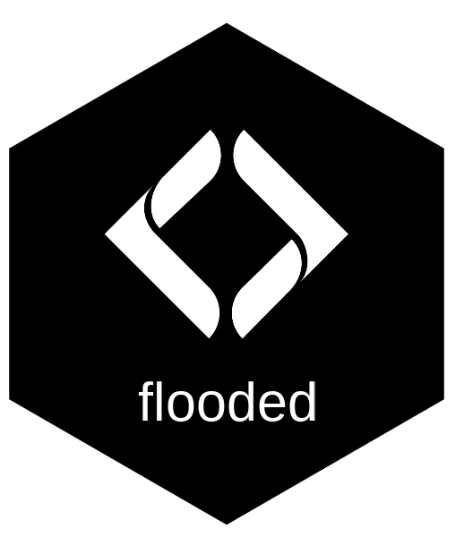
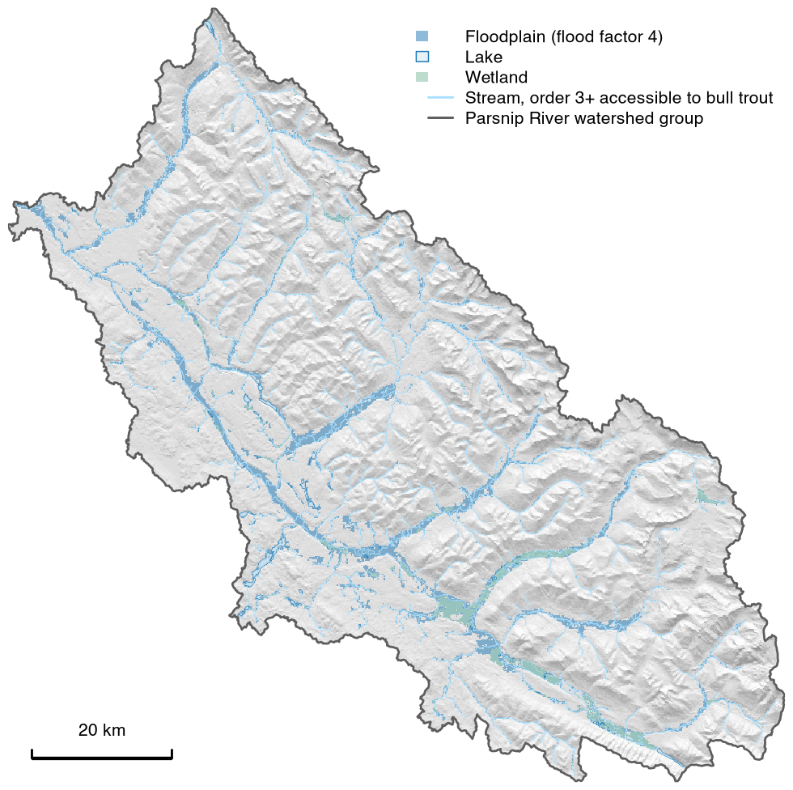

# flooded 

<!-- badges: start -->
[](https://lifecycle.r-lib.org/articles/stages.html#experimental)
<!-- badges: end -->

> Map floodplains from an elevation model and a stream network.

flooded maps floodplains and unconfined valley bottoms from an elevation model and a stream
network with the Valley Confinement Algorithm, keeping ground that is gentle, near a stream,
reachable from it without climbing, and low relative to it. It classifies terrain and does not
simulate floods, so its output is a screening map, not a field-validated floodplain. Floodplain
that a coarse elevation model maps and 1 m lidar excludes, mostly on steep ground, is where to look
for roads, rail grades, dykes or fill that may cut a floodplain off from its river, and so where
reconnection could be planned.

It fetches an elevation model for an area, maps three preset flood levels from active channel to
valley bottom, and attributes one floodplain to each watercourse that shares it, carrying
per-reach attributes such as fish habitat onto the ground beside each reach.



*The floodplain at flood factor 4 in the Parsnip River watershed group, British Columbia, mapped
at 30 m from the MRDEM-30 elevation model with lakes and wetlands included. Only streams of order
3 and up that bull trout can reach were modelled, so smaller streams and those above barriers have
no floodplain here.*

## Installation

```r
pak::pak("NewGraphEnvironment/flooded")
```

flooded is under active development and its functions change between releases (see
[NEWS](NEWS.md)). Pin a release for reproducible work:
`pak::pak("NewGraphEnvironment/flooded@vX.Y.Z")`.

A run needs an elevation raster in a projected CRS with metre units, and stream lines that carry
upstream area in hectares; mean annual precipitation is optional. The default elevation model,
MRDEM-30, covers Canada and is read over the internet with no credentials.

## Example

A 6 km reach of the Bulkley River is bundled with the package. At the default flood level
(flood factor 6, valley bottom), its floodplain attributed to each watercourse:

```r
library(flooded)

dem <- terra::rast(system.file("testdata/dem.tif", package = "flooded"))
streams <- sf::st_read(system.file("testdata/streams.gpkg", package = "flooded"), quiet = TRUE)

valleys <- fl_valley_confine(
  dem, streams,
  area_field = "upstream_area_ha",
  precip = fl_stream_rasterize(streams, dem, field = "map_upstream")
)

by_river <- fl_valley_attribute(valleys, streams, group = "gnis_name", dem = dem)
by_river$area_ha <- round(as.numeric(sf::st_area(by_river)) / 1e4)
sf::st_drop_geometry(by_river)[, c("gnis_name", "area_ha")]
#>            gnis_name area_ha
#> 1      Bulkley River     264
#> 2      Cesford Creek     112
#> 3    Richfield Creek     130
#> 4 Robert Hatch Creek      50
#> 5               <NA>      99
```

Rows overlap where two watercourses share valley floor; the whole floodplain here is 287 ha.

## Learn more

- [Valley confinement](https://newgraphenvironment.github.io/flooded/articles/valley-confinement.html):
  the pipeline step by step on the bundled reach, the three flood levels, and whose floodplain is
  whose.
- [Bring your own DEM via STAC](https://newgraphenvironment.github.io/flooded/articles/stac-dem.html):
  the same reach from the 25 m provincial model and from lidar, and the steep-sided grades and
  fill that 1 m lidar resolves.
- [Watershed-scale floodplain delineation](https://newgraphenvironment.github.io/flooded/articles/pars-floodplain.html):
  a whole watershed group, the Parsnip, from a fetched elevation model.
- [Function reference](https://newgraphenvironment.github.io/flooded/reference/).

## Ecosystem

| Package | Role |
|---------|------|
| [fresh](https://github.com/NewGraphEnvironment/fresh) | Stream network modelling engine: segment, classify, cluster, aggregate |
| [link](https://github.com/NewGraphEnvironment/link) | Intrinsic habitat models: develop, test and communicate |
| **flooded** | Delineate floodplain extents from DEMs and stream networks (this package) |
| [drift](https://github.com/NewGraphEnvironment/drift) | Track land cover change within floodplains over time |
| [floodplains](https://github.com/NewGraphEnvironment/floodplains) | Floodplain and land cover change modelling for BC watershed groups |
| [cd](https://github.com/NewGraphEnvironment/cd) | Climate departure analysis from ERA5-Land reanalysis |
| [breaks](https://github.com/NewGraphEnvironment/breaks) | Delineate sub-basins from break points on stream networks |
| [fly](https://github.com/NewGraphEnvironment/fly) | Estimate airphoto footprints and select optimal coverage for a study area |
| [diggs](https://github.com/NewGraphEnvironment/diggs) | BC Historic Airphoto Explorer (interactive Shiny app) |

Land cover change: fresh (network) &rarr; flooded (floodplains) &rarr; drift (land cover change)

## Data and methods it builds on

- The Valley Confinement Algorithm of the [USDA VCA Toolbox](https://www.fs.usda.gov/rm/boise/AWAE/projects/valley_confinement.shtml),
  with code adapted from [BlueGeo](https://github.com/bluegeo/bluegeo) (Devin Cairns, MIT) and the
  lateral habitat model of [bcfishpass](https://github.com/smnorris/bcfishpass) (Simon Norris,
  Apache 2.0).
- The bankfull regression of Hall et al. (2007), which sets how far above each stream the flood
  levels sit, and the flood-factor ranges of Nagel et al. (2014)
  ([methodology](https://github.com/NewGraphEnvironment/flooded/blob/main/inst/notes/methodology.md)).
- NRCan's [MRDEM-30](https://open.canada.ca/data/en/dataset/18752265-bda3-498c-a4ba-9dfe68cb98da),
  the elevation model fetched by default.
- In the bundled data and vignettes: the BC Freshwater Atlas, stream attributes from bcfishpass
  (upstream area, precipitation, channel width, fish access), and BC lidar from the
  `stac-elevation-bc` catalogue.
- What the model maps, what a flood factor means, and what can be claimed from the output:
  [floodplain interpretation](https://github.com/NewGraphEnvironment/flooded/blob/main/inst/notes/floodplain_interpretation.md).

## Citation

Cite flooded from [`CITATION.cff`](CITATION.cff), or with "Cite this repository" on GitHub.

## License

MIT (see [`LICENSE`](LICENSE)). Adapted code is attributed in [`LICENSE.note`](LICENSE.note), and
the licences of the data bundled with the package are in [`inst/NOTICE.md`](inst/NOTICE.md).
